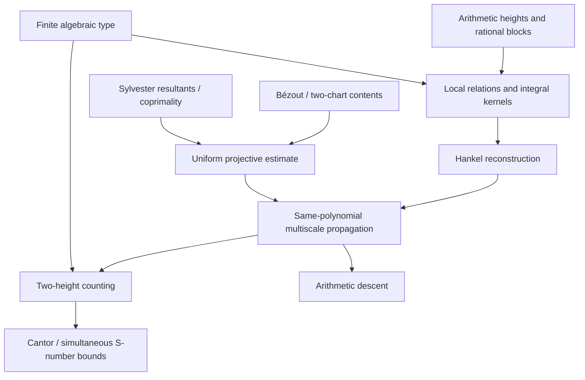

# DiophantineRigidity

**Machine-checked foundations for Diophantine rigidity of analytic graphs**  
Lean 4.24.0 · mathlib v4.24.0 · independent repository · research formalization in progress

[](https://github.com/DiegoMarquesMath/DiophantineRigidity/actions/workflows/lean.yml)
[](https://lean-lang.org/)
[](https://github.com/leanprover-community/mathlib4)

*A formal verification project accompanying Diego Marques's manuscript, **Diophantine Rigidity of Analytic Graphs**.*

> [!IMPORTANT]
> **Current status: substantial arithmetic and algebraic infrastructure has been formalized; the new principal theorems are not yet machine-certified.** In particular, the arbitrary-degree two-height counting theorem, all-degree S-number Cantor theorem, full projective-content estimate, multiscale propagation and arithmetic descent remain open formalization obligations. A green CI check proves only the exact declarations compiled and audited in that commit.

## The mathematical goal

Let $f:I\to\mathbb R$ be real analytic and transcendental over $\mathbb R(X)$. Count reduced rationals $r=p/q\in J\Subset I$, with $Q\le q<2Q$, for which there exists a nonzero integer polynomial $P\in\mathbb Z[Y]$ satisfying

$$
\deg P\le m,\qquad B\le H(P)<2B,\qquad
|P(f(r))|\le L B^{-w}.
$$

The target uniform estimate is

$$
N_{f,m}(Q,B,w)\ll Q^{2-\eta}
\quad(w>2m-1,\;Q^{u_0}\le B\le Q^U),
$$

with the constants chosen before $Q$ and $B$. Exact zeros, factors, degree drops, and nonprimitive witnesses are not discarded.

The manuscript's target consequences are a single Cantor set of Liouville arguments whose images have simultaneously controlled Mahler exponents (and irrationality exponent $2$), arithmetic descent for algebraic analytic branches, and a new route to entire-function rigidity in Mahler's problem.

**These targets are not assertions of already completed Lean proofs.**

## What is already present in the integration branch

The code accumulated across the previously separate proof PRs is brought together here rather than treated as new work. The formalized components include:

| Area | Lean modules | Scope |
|---|---|---|
| Rational blocks and witness arithmetic | `Witnesses`, `WitnessMonotonicity`, `FareyBounds`, `ArithmeticSpecialization` | Finite rational sets, degree-monotone witnesses, denominator-cleared evaluations and Farey bounds |
| Integral polynomial infrastructure | `IntegerContent`, `BivariateSpecialization`, `TwoChartDivisibility` | Coefficient content, integer specializations, elementary two-chart divisibility |
| Reconstruction preliminaries | `HankelPairing`, `PropagationExponents` | Field pairing and numerical exponent identities, **not** full Hankel reconstruction or propagation |
| Bézout and projective bridge | `BezoutCertificates`, `ProjectiveBezoutBridge`, `ProjectiveReciprocity` | Conditional Bézout identities, denominator clearing, reflection and content divisibility |
| Root avoidance and coprimality | `BoundedRootAvoidance`, `PolynomialRootAvoidance`, `SelectedCombination`, `SelectedIntegerCombination`, `ComplexCoprimality`, `RationalCoefficientCoprimality` | Bounded parameter selection and elimination of pointwise common-root hypotheses under explicit coprimality assumptions |
| Sylvester theory | `LinearResultant`, `SylvesterKernel`, `SylvesterCertificates`, `SylvesterHeightBound`, `ResultantBaseChange` | Integral certificates, determinant bounds, exact-degree nonvanishing and base change |
| Proven legacy results | `LegacyBridge` and pinned `MahlerLean` dependency | Rational spacing and an earlier *independent* entire-rigidity proof; does not substitute for the new counting route |

Declarations in these modules have exact Lean statements. They are not automatically the full manuscript lemmas bearing related names.

## Verification provenance

The project was initially bootstrapped on `main` at `b342c9bf`. Research code was developed in multiple PR branches, so inspecting only `main` seriously understates progress.

- [PR #10 — nominal-degree Sylvester resultant](https://github.com/DiegoMarquesMath/DiophantineRigidity/pull/10), commit `84f8fc5041899d20a7e9aa8f588d808e881e1f1d`: [successful CI](https://github.com/DiegoMarquesMath/DiophantineRigidity/actions/runs/41851694299). This branch contains the accumulated arithmetic/projective/root-avoidance stack.
- [PR #9 — coprimality over rational coefficient polynomials](https://github.com/DiegoMarquesMath/DiophantineRigidity/pull/9), commit `1738c9db83820b1c19a9913cffcc9a2867e5f402`: [successful CI](https://github.com/DiegoMarquesMath/DiophantineRigidity/actions/runs/41850220738).
- [PR #11 — integral-to-complex resultant base change](https://github.com/DiegoMarquesMath/DiophantineRigidity/pull/11), commit `6e6dd5e7487e7971f0f5c1646f0eb33f143910ce`: [successful CI](https://github.com/DiegoMarquesMath/DiophantineRigidity/actions/runs/41852264160).
- [PR #12 — witness monotonicity](https://github.com/DiegoMarquesMath/DiophantineRigidity/pull/12): added to this integration branch; independent CI certification is required.
- [MahlerLean](https://github.com/DiegoMarquesMath/MahlerLean) is a separate project, included as a fixed Git dependency; [its analytic-graphs PR #4](https://github.com/DiegoMarquesMath/MahlerLean/pull/4) is a scaffold and statement mapping, **not** an additional proof of the new main theorem.

**The combined integration commit needs its own green CI run**; separate successes do not logically imply compilation after combination. No proprietary/local manuscript or uncommitted files are published here.

## Formalization plan

| Gate | Objective | Current assessment |
|---|---|---|
| 01 | Exact revised source, source hash and statement map | Partial; the revised TeX remains local |
| 02 | Arithmetic and integer polynomial foundations | Substantial verified branch-level work; source-fidelity audit incomplete |
| 03 | Finite algebraic type and uniform jets | Open in this project |
| 04 | Local determinant relations | Open |
| 05 | Hankel reconstruction | Pairing proved; main reconstruction open |
| 06 | Projective content | Several Bézout and chart sublemmas proved; full estimate open |
| 07 | Integral resultants | Significant Sylvester results proved; full manuscript lemma open |
| 08 | Uniform multiscale propagation | Exponent identities proved; propagation open |
| 09 | Arbitrary-degree two-height counting | Open |
| 10 | Simultaneous Cantor and S-numbers | Open (legacy Cantor theorem is a different statement) |
| 11 | Arithmetic descent | Open |
| 12 | Full proof, source and axiom certification | Open |

See [detailed status](docs/STATUS.md), [formalization plan](docs/FORMALIZATION_PLAN.md), [proof contracts](docs/PROOF_CONTRACTS.md) and [verification standards](docs/VERIFICATION.md).

## Dependency and proof architecture



## Reproduce the proof audit

```bash
git clone https://github.com/DiegoMarquesMath/DiophantineRigidity.git
cd DiophantineRigidity
git checkout integration/ath-recovered-work-20261104
lake exe cache get
bash scripts/check.sh
```

The check builds the library, compiles each module, runs `scripts/Audit.lean`, and rejects `sorryAx` or unauthorized axioms. Standard logical axioms such as `propext`, `Classical.choice` and `Quot.sound` are permitted.

**For a mathematical certification:** additionally compare every final Lean theorem type with the exact TeX statement, including quantifier order, all uniform constants and endpoint cases. Record the verified commit SHA and the CI run; never cite only a moving branch.

## Continuity and publication

The [integration record](docs/INTEGRATION_2026-11-04.md) identifies which PR branches were carried forward and what remains outside public GitHub. Future work should branch from the integrated code, not recreate previously audited sublemmas. The authoritative revised manuscript is deliberately excluded from Git by the `paper/` policy.

Maintainer: **Diego Marques**, Department of Mathematics, Universidade de Brasília.  
*Precise claims. Reproducible proofs. Explicit remaining obligations.*
