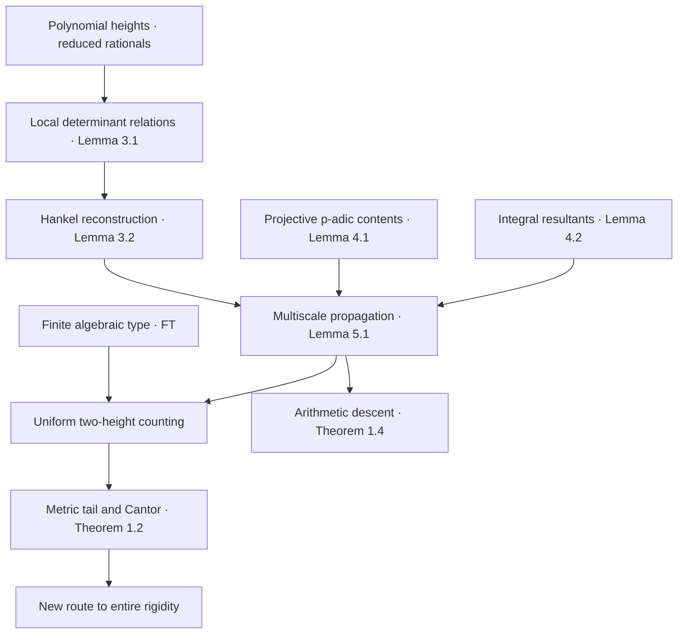

# DiophantineRigidity

**Formal Verification of Diophantine Rigidity**  
*A Lean 4 and mathlib project accompanying research by Diego Marques*

[](https://lean-lang.org/)
[](https://github.com/leanprover-community/mathlib4)
[](https://github.com/DiegoMarquesMath/DiophantineRigidity/actions/workflows/lean.yml)

This repository is the **independent formalization project** for *Diophantine Rigidity of Analytic Graphs*. Its objective is to turn the complete mathematical argument—from local determinants and projective contents to counting, Cantor sets and arithmetic descent—into Lean declarations whose exact statements and assumptions can be checked against the paper.

The repository has its **own Git history, Lean library, CI and proof-verification record**. Selected results from the earlier [MahlerLean](https://github.com/DiegoMarquesMath/MahlerLean) project are imported as a **pinned dependency**, rather than copying its history or treating its earlier theorems as proofs of the new ones.

> [!IMPORTANT]
> **Verification status.** The initial code contains definitions of polynomial witnesses and small bridges to previously formalized results. The new arbitrary-degree two-height counting theorem, simultaneous S-number theorem and arithmetic descent are **formalization goals, not yet certified Lean theorems**. A passing build only verifies the declarations actually present.

## Main mathematical objective

Let $f:I\to\mathbb R$ be real analytic and transcendental over $\mathbb R(X)$, and let $J\Subset I$ be a compact interval. For reduced fractions $r=p/q\in J$ with $Q\le q<2Q$, consider nonzero $P\in\mathbb Z[Y]$ satisfying

$$
\deg P\le m,\qquad
B\le H(P)<2B,\qquad
|P(f(r))|\le L B^{-w},
$$

where $H(P)$ is the maximum absolute coefficient. Each rational argument is counted only once, and **exact zeros are included**.

The central theorem targeted for formalization is the uniform two-height estimate

$$
\boxed{\ N_{f,m}(Q,B,w)\ll Q^{2-\eta}\ }
\quad\text{for}\quad
w>2m-1,\qquad Q^{u_0}\le B\le Q^U.
$$

Its metric consequence asserts the existence, in every nonempty open subinterval, of a **single Cantor set** $K\subset\mathscr L$ of Liouville numbers such that, for every $\xi\in K$,

$$
f(\xi)\text{ is transcendental},\qquad
w_m(f(\xi))\le 2m-1\quad(\forall m\ge1),\qquad
\mu(f(\xi))=2.
$$

A second consequence is **arithmetic descent**: positive-density approximate algebraic specializations at the natural height scale $Q^d$ force the defining equation of an algebraic analytic branch to be rational up to scalar. The known entire-function rigidity conclusion related to Mahler's 1984 problem is also a formalization target *via the new chain of results*.

**These are mathematical statements to be formalized, not claims that their new proofs are already checked.**

## Proof architecture



The critical proof obligations are **uniformity in the two independent heights**, **content estimates in both $p$-adic charts**, and **propagation of the same reconstructed polynomial without accumulating interpolation losses**. The Cantor construction must impose all degree bounds simultaneously on every branch.

## Verified, reused and open

| Component | Source of evidence | Status |
| --- | --- | --- |
| Polynomial height and witness definitions | [`Witnesses.lean`](DiophantineRigidity/Witnesses.lean) | Initial definitions; CI check required |
| Farey separation | [`LegacyBridge.lean`](DiophantineRigidity/LegacyBridge.lean), imported from MahlerLean | Previously proved lemma; bridge check required |
| Entire-function rigidity statement | [`LegacyBridge.lean`](DiophantineRigidity/LegacyBridge.lean), imported from MahlerLean | Earlier independent proof route; **not** the new S-number derivation |
| Finite algebraic type, local determinants and Hankel reconstruction | [Formalization plan](docs/FORMALIZATION_PLAN.md) | Not yet formalized in this project |
| Projective content, resultants and propagation | [Proof contracts](docs/PROOF_CONTRACTS.md) | Not yet formalized |
| Arbitrary-degree counting, Cantor/S-number images and arithmetic descent | [Status register](docs/STATUS.md) | Not yet formalized |

For the exact original formalized statements, see the [MahlerLean theorem declarations](https://github.com/DiegoMarquesMath/MahlerLean/blob/5a91bd60ebb8200886bdca21cc9c178bfb1f5f1d/MahlerLean/CurrentTheoremOne.lean). **Earlier degree-one approximation does not imply the new arbitrary-degree theorem.**

## Repository layout

```text
DiophantineRigidity.lean            Library entry point
DiophantineRigidity/
  Witnesses.lean                    Small polynomial-value witnesses
  LegacyBridge.lean                 Pinned, exact imports from MahlerLean
lakefile.toml                       Independent Lean package
lean-toolchain                      Lean 4.24.0
scripts/check.sh                    Local build and axiom audit
scripts/Audit.lean                  Audited declarations
.github/workflows/lean.yml         GitHub Actions
AGENTS.md                           Strict mathematical agent instructions
docs/
  FORMALIZATION_PLAN.md              Twelve proof gates
  PROOF_CONTRACTS.md                 Statement-level specifications
  REUSE_MAP.md                       Exact reuse and non-reuse boundaries
  VERIFICATION.md                    Criteria for claiming a proof complete
  STATUS.md                          Evidence-backed milestone tracker
  PUBLISH.md                         Safe first publication instructions
paper/README.md                      Local manuscript policy
```

The revised manuscript files `ATH_rev.tex` and `ATH_rev.pdf` belong in a local, Git-ignored `paper/` folder. They are **not published by this bootstrap**, and statement-level excerpts must be reviewed for publication separately.

## Build and audit

The project pins Lean **4.24.0**, mathlib **v4.24.0**, and a particular MahlerLean commit. Its Git history is independent of the earlier project.

```bash
git clone https://github.com/DiegoMarquesMath/DiophantineRigidity.git
cd DiophantineRigidity
lake exe cache get
bash scripts/check.sh
```

During early development, a build and axiom audit of this scaffold certifies **only existing declarations**, not any unimplemented theorem. At each milestone the audited declaration list is extended, its actual Lean type compared with the manuscript, and the proof recorded at an exact commit.

## Formalization roadmap

The verification program is divided into **12 independently reviewable gates**: source locking; arithmetic foundations; finite type; determinants; Hankel reconstruction; projective contents; resultants; propagation; the two-height theorem; Cantor and S-numbers; arithmetic descent; and final cross-check and certification.

See the [full plan](docs/FORMALIZATION_PLAN.md), [mathematical contracts](docs/PROOF_CONTRACTS.md), [reuse map](docs/REUSE_MAP.md), and [verification standard](docs/VERIFICATION.md). An agent must not change the mathematical assertion to make a proof easier, nor report a theorem as verified because an unrelated or weaker statement compiles.

## Reproducibility, provenance and citation

- Each certified theorem must have a precise paper ↔ Lean statement correspondence and a checked `#print axioms` output.
- No admitted proofs, private theorem-equivalent hypotheses or added nonstandard axioms can be used to close a research obligation.
- Cite **the exact verified commit**, not only the moving `main` branch or its badge.
- The legacy MahlerLean dependency is pinned and remains independently maintained.
- For software citation use [`CITATION.cff`](CITATION.cff); cite the corresponding mathematical paper separately.

**Author / maintainer:** [Diego Marques](https://github.com/DiegoMarquesMath), Department of Mathematics, Universidade de Brasília.

---

*Exact statements. Explicit dependencies. Machine-checked proofs.*
